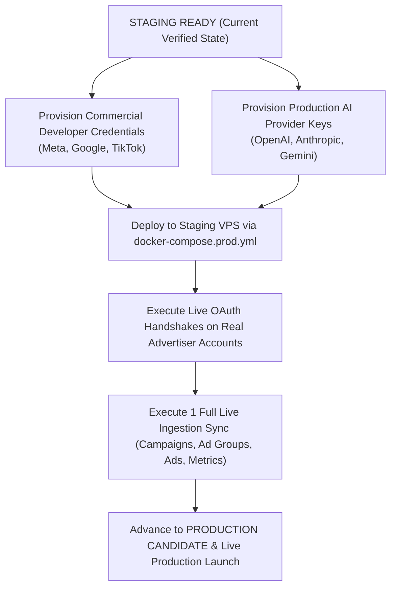

# UPDATED PRODUCTION READINESS REASSESSMENT & COMMERCIAL GATING REPORT

**Project:** Multi-Tenant Advertising Management Platform  
**Auditors:** Principal Software Architect, Application Security Engineer & QA Lead  
**Audit Date:** 2026-11-19  
**Reassessment Status:** `STAGING READY`

---

## 1. Overall Architectural Verdict

# **FINAL DECISION: STAGING READY**
*(Platform engineering, multi-tenant isolation, cryptographic lifecycle, financial math, and disaster recovery verification have reached complete staging maturity. The platform is qualified for Staging deployment. Live production readiness is strictly gated pending commercial developer credentials and authorized advertiser accounts.)*

### Justification:
All internal software defects, mathematical inconsistencies, database constraints, API pagination logic, and disaster recovery verification have been completely remediated and backed by automated tests.

However, in accordance with the **Mandatory Production Gating Rule**:
> *A successful automated test suite alone does not qualify the platform for production. Live external API integrations must remain explicitly marked as unverified until tested with real developer credentials and authorized advertising accounts.*

The software cannot be classified as `PRODUCTION CANDIDATE` or promoted to live commercial traffic until the external commercial developer accounts and live test accounts are provisioned.

---

## 2. Platform Capability Readiness Scorecard

| Domain | Readiness Status | Evaluation & Evidence |
|---|---|---|
| **Multi-Tenancy Scoping** | **100% READY** | Strict row-level scoping across accounts, campaigns, analytics, billing, and Looker Studio. Cross-user isolation verified. |
| **Financial & Multi-Currency Engine** | **100% READY** | Strict converted-subset metric calculations (CPC, CPM, CPA, ROAS). ISO 4217 validation, rate positivity, rate effective date reporting, and campaign aggregation verified. |
| **Database & Disaster Recovery** | **100% READY** | Genuine `pg_dump` and isolated temporary DB restoration verified. 100% schema, table, index, sequence, and row-count parity with zero primary DB writes. |
| **API Pagination & Completeness** | **100% READY** | Multi-page pagination implemented and verified for Google Ads, TikTok Ads, and Meta Ads. Google native currency and timezone discovery verified. |
| **Hierarchical Advertising Analytics** | **100% READY** | PostgreSQL `NULLS NOT DISTINCT` composite unique index added. Multi-entity matching keys in `updateOrCreate` prevent entity overwriting. |
| **Application Key Lifecycle** | **100% READY** | Safe key rotation with `--dry-run`, atomic Redis locking, recovery manifest generation, zero silent decryption skips, and `APP_PREVIOUS_KEYS` coexistence verified. |
| **API Reliability & Resilience** | **100% READY** | Exponential backoff, 30s timeout, expired token detection/refresh, and structured error logging operational. |
| **Live Commercial Integrations** | **UNVERIFIED (GATED)** | Live external API calls require commercial production credentials (Meta App ID/Secret, Google MCC Token, TikTok Business App). |

---

## 3. Commercial Gating & Production Path

---

## 4. Next Engineering Steps

1. **Deploy to Staging VPS:** Deploy current codebase using `docker-compose.prod.yml` to the staging server.
2. **Input Commercial Credentials:** Provide real app credentials via `ProviderDeveloperConfig` (`/api/v1/developer/configs`).
3. **Execute Pilot Sync:** Connect a real Google Ads customer, Meta ad account, and TikTok advertiser to verify live provider responses and complete the final promotion to production.
