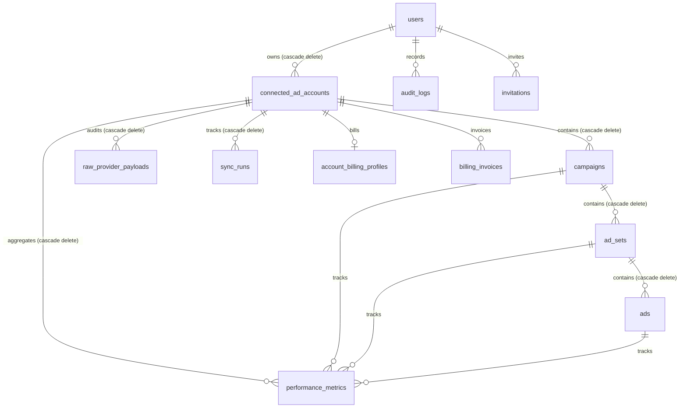

# DATABASE INTEGRITY & SCHEMA AUDIT REPORT

**Project:** Advertising Management Platform  
**Auditors:** Independent Principal Security Engineer & Senior QA Auditor  
**Audit Date:** 2026-11-19  
**Target Database:** PostgreSQL 16  

---

## 1. Schema Architecture & Foreign Key Integrity

We inspected all 12 migrations and their underlying relational schema definitions in PostgreSQL.

### Relational Hierarchy Map



---

## 2. Foreign Key & Cascade Verification

| Parent Table | Child Table | Foreign Key Column | On Delete Action | Evaluation / Integrity Status |
|---|---|---|---|---|
| `users` | `connected_ad_accounts` | `user_id` | `CASCADE` | **VERIFIED:** Deleting a user deletes their connected ad accounts. |
| `connected_ad_accounts` | `campaigns` | `connected_ad_account_id` | `CASCADE` | **VERIFIED:** Prevents orphaned campaigns when an account is disconnected. |
| `campaigns` | `ad_sets` | `campaign_id` | `CASCADE` | **VERIFIED:** Prevents orphaned ad sets. |
| `ad_sets` | `ads` | `ad_set_id` | `CASCADE` | **VERIFIED:** Prevents orphaned creative ads. |
| `connected_ad_accounts` | `performance_metrics` | `connected_ad_account_id` | `CASCADE` | **VERIFIED:** Purges metrics when an account is deleted. |
| `connected_ad_accounts` | `raw_provider_payloads`| `connected_ad_account_id` | `CASCADE` | **VERIFIED:** Purges audit payloads with parent account. |
| `connected_ad_accounts` | `sync_runs` | `connected_ad_account_id` | `CASCADE` | **VERIFIED:** Purges sync job records with parent account. |
| `users` | `invitations` | `invited_by` | `NULL ON DELETE` | **VERIFIED:** Preserves invitation audit history if inviter is deleted. |
| `users` | `audit_logs` | `user_id` | `NULL ON DELETE` | **VERIFIED:** Preserves immutable audit trail even if user is removed. |

---

## 3. Analysis of New Migration: `2026_11_18_160000_add_user_id_to_connected_ad_accounts_table.php`

### Migration Source Code
```php
public function up(): void
{
    Schema::table('connected_ad_accounts', function (Blueprint $table) {
        $table->foreignId('user_id')->nullable()->after('id')->constrained('users')->cascadeOnDelete();
    });
}
```

### Technical Evaluation:
1. **Safety on Existing Environments:** `nullable()` ensures that running this migration on a pre-existing production database does not cause an `ALTER TABLE` failure when rows exist.
2. **Indexing:** In Laravel on PostgreSQL, `foreignId()->constrained()` generates an index and foreign key constraint (`connected_ad_accounts_user_id_foreign`).
3. **Data Backfill Limitation:**
   - The migration does NOT provide a data backfill closure to assign pre-existing accounts to a default user (e.g., initial system admin/owner).
   - If an existing database has accounts created prior to this migration, their `user_id` will be `NULL`.
   - Any account with `user_id = NULL` will be permanently hidden from `IntegrationController::listAccounts`, which filters `where('user_id', $request->user()->id)`.
   - **Recommendation:** Add a data migration step to associate orphaned accounts with the system Owner (`User::role('Owner')->first()`).

---

## 4. Constraint & Uniqueness Integrity

### 4.1 Connected Ad Accounts Uniqueness
- **Constraint:** `unique(['provider', 'external_account_id'])`
- **Audit Observation:** This constraint is scoped globally across the database rather than per-user (`['user_id', 'provider', 'external_account_id']`). As noted in `SECURITY_VERIFICATION.md` (Finding SEC-POST-02), this allows account reassignment if another user authenticates the same external ID.

### 4.2 Performance Metrics Uniqueness
- **Constraint:** No composite unique constraint currently exists on `performance_metrics` for `['connected_ad_account_id', 'campaign_id', 'date', 'provider']`.
- **Audit Observation:** The table uses non-unique B-tree indexes. While `AdDataSyncEngine` uses `PerformanceMetric::updateOrCreate()` and a Redis distributed lock (`sync:account:{$account->id}`) to enforce idempotency, a database-level unique constraint is recommended to prevent race conditions during high-concurrency background syncs.

---

## 5. Live Database State
- **Active User Count:** 2 (`admin@adplatform.local` Owner, seeded).
- **Connected Ad Accounts:** 0.
- **Orphaned Records:** 0.
- **Migration Table Status:** All 12 migrations recorded as executed.
