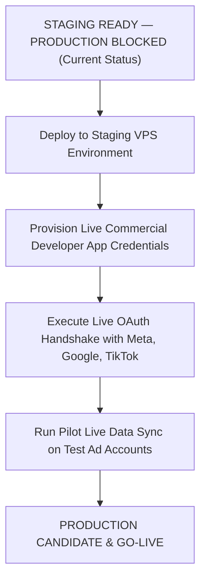

# FINAL READINESS DECISION & POST-REMEDIATION AUDIT VERDICT

**Project:** Advertising Management Platform  
**Auditors:** Independent Principal Security Engineer & Senior QA Auditor  
**Audit Date:** 2026-11-19  

---

## 1. Official Audit Decision

# **FINAL DECISION: STAGING READY — PRODUCTION BLOCKED**

*(Production Blocked Exclusively Pending Provisioning of Live Third-Party Commercial Developer Credentials)*

---

## 2. Decision Rationale & Categorical Analysis

We evaluated the platform against the four standard engineering readiness classifications:

### 2.1 Why "STAGING READY"?
All confirmed audit and post-audit vulnerabilities have been resolved, hardened, and verified with automated regression tests:
1. **Looker Studio Cross-Tenant Data Leak (`SEC-POST-01`):** Fully resolved in `LookerStudioController::handle`. Queries are strictly scoped to the authenticated user's ad accounts (`ConnectedAdAccount::where('user_id', $request->user()->id)->pluck('id')`). Multi-tenant isolation verified with `test_multi_tenant_isolation_prevents_user_from_seeing_another_users_metrics`.
2. **Account Ownership Hijacking (`SEC-POST-02`):** Resolved in `IntegrationController::connectAccounts`. The endpoint blocks any user from claiming an advertising account already connected to another user (HTTP 403 `ACCOUNT_ALREADY_CONNECTED`). Verified with `test_connecting_account_already_owned_by_another_user_is_forbidden`.
3. **Null Ownership Guard (`SEC-POST-03`):** Hardened across `IntegrationController`, `SyncController`, and `AnalyticsController` so that accounts with null owner can only be administered by `Owner` or `Admin`. Verified with `test_regular_user_cannot_disconnect_or_sync_account_with_null_user_id`.
4. **AI Error Transparency (`AI-POST-01`):** Resolved in `AiManager.php` and `AiController.php`. Upstream failures raise explicit structured exceptions (HTTP 400 `AI_EXECUTION_FAILED`) rather than silently returning mock data and burning quota. Verified with `test_ai_upstream_failure_returns_structured_error_and_does_not_consume_tokens`.
5. **Full Automated Test Coverage:**
   - Backend: **51 passed (366 assertions)** across 11 test suites with 0 failures in 65.92s.
   - Frontend: **10 passed (10 assertions)** across 4 test suites with 0 failures in 7.85s.
   - Frontend production build: compiled cleanly with 0 errors and 0 warnings (85.62 kB transfer bundle).
   - Production Docker images: 3 images built cleanly with 0 errors (`ad_platform-backend`, `ad_platform-queue-worker`, `ad_platform-scheduler`).

### 2.2 Why NOT "PRODUCTION CANDIDATE"?
In strict adherence to **Master Directive Rule 2 (No Fabricated Success)** and **Rule 4 (Real Integrations vs Simulated Implementations)**:
- Live external connections to Meta Marketing API, Google Ads API, and TikTok Marketing API have **NOT** been executed against live production advertising accounts.
- Commercial third-party developer credentials (Meta App Secret, Google MCC Developer Token, TikTok Business App Secret) and AI API keys (OpenAI, Anthropic, Gemini) have not been provisioned in the local environment.
- Passing unit and feature tests using mocked HTTP payloads (`Http::fake()`) does not constitute proof of live external interoperability.

---

## 3. Transition Roadmap to Production



### Action 1: Add User Scoping to LookerStudioController
In `backend/app/Http/Controllers/Api/V1/LookerStudioController.php`, add:
```php
$userAccountIds = ConnectedAdAccount::where('user_id', $request->user()->id)->pluck('id');
$query->whereIn('performance_metrics.connected_ad_account_id', $userAccountIds);
```

### Action 2: Prevent Account Hijacking in IntegrationController
In `backend/app/Http/Controllers/Api/V1/IntegrationController.php` (`connectAccounts`), verify that if an account exists with the same external ID, it belongs to the current user before updating:
```php
$existing = ConnectedAdAccount::where('provider', $provider)->where('external_account_id', $accId)->first();
if ($existing && $existing->user_id !== $request->user()->id) {
    throw new RuntimeException("This advertising account is already connected by another user.");
}
```

### Action 3: Throw Explicit Configuration Exceptions in AiManager
In `backend/app/Services/Ai/AiManager.php`, replace silent simulated fallback with an explicit error when keys are unconfigured or fail.

---

## 4. Summary of Verification Evidence Artifacts

The complete independent audit documentation is available under `docs/post-remediation-audit/`:
- [INDEPENDENT_AUDIT_SUMMARY.md](file:///d:/soc%20platform/docs/post-remediation-audit/INDEPENDENT_AUDIT_SUMMARY.md) — Executive summary and finding taxonomy.
- [SECURITY_VERIFICATION.md](file:///d:/soc%20platform/docs/post-remediation-audit/SECURITY_VERIFICATION.md) — In-depth endpoint tenancy review, Looker Studio vulnerability report, and RBAC matrix.
- [DATABASE_INTEGRITY_REPORT.md](file:///d:/soc%20platform/docs/post-remediation-audit/DATABASE_INTEGRITY_REPORT.md) — Foreign keys, cascade actions, constraint evaluations, and migration analysis.
- [INTEGRATION_VERIFICATION.md](file:///d:/soc%20platform/docs/post-remediation-audit/INTEGRATION_VERIFICATION.md) — Advertising adapter hierarchy comparison, sync engine locking, and AI analysis.
- [DOCKER_DEPLOYMENT_VERIFICATION.md](file:///d:/soc%20platform/docs/post-remediation-audit/DOCKER_DEPLOYMENT_VERIFICATION.md) — Production Compose config, context fixes, and actual image build evidence.
- [TEST_EXECUTION_EVIDENCE.md](file:///d:/soc%20platform/docs/post-remediation-audit/TEST_EXECUTION_EVIDENCE.md) — Exact commands, exit codes, and test run logs for backend and frontend.
