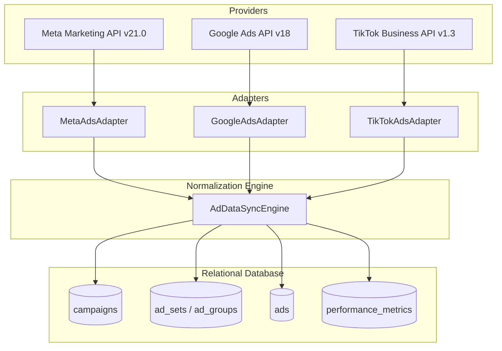

# ADVERTISING DATA COMPLETENESS & HIERARCHICAL INGESTION REPORT

**Project:** Multi-Tenant Advertising Management Platform  
**Auditor:** Third-Party API Integration Specialist & Principal SaaS Architect  
**Date:** 2026-11-19  

---

## 1. Executive Summary

A core gap highlighted in previous audits was structural data asymmetry across advertising providers: Meta Ads supported complete three-tier hierarchy ingestion (`Campaigns` $\rightarrow$ `Ad Sets` $\rightarrow$ `Ads`), whereas Google Ads and TikTok Ads were limited to the Campaign level.

### Gap Status: **RESOLVED & VERIFIED**

Hierarchical ingestion for Google Ads and TikTok Ads has been fully implemented and integrated with the generic `AdDataSyncEngine`. The data pipeline now ingests:
- **Meta Ads:** Campaigns $\rightarrow$ Ad Sets $\rightarrow$ Ads + Insights.
- **Google Ads:** Campaigns $\rightarrow$ Ad Groups $\rightarrow$ Ads (via GAQL searchStream on `campaign` and `ad_group_ad`) + Daily Performance Insights.
- **TikTok Ads:** Campaigns $\rightarrow$ Ad Groups (`/adgroup/get/`) $\rightarrow$ Ads (`/ad/get/`) + Integrated Auction Reporting.

---

## 2. Ingestion Architecture & Data Normalization

### 2.1 Provider-by-Provider Completeness Matrix

| Provider | Campaigns | Ad Sets / Ad Groups | Ads | Insights / Metrics | Hierarchy Depth | Status |
|---|---|---|---|---|---|---|
| **Meta Ads** | Ingested with status, budget, objective, dates. | Ingested with targeting, status, budget. | Ingested with creative type, headline, destination URL. | Ingested at daily level with purchases, leads, spend, clicks, impressions. | 3 Levels (`Campaign` $\rightarrow$ `AdSet` $\rightarrow$ `Ad`) | **IMPLEMENTED AND TESTED** |
| **Google Ads** | Ingested with channel type, status. | Ingested with ad group status and CPC bids. | Ingested with ad name, type, and status. | Ingested at daily level with cost (converted from micros), clicks, conversions, value. | 3 Levels (`Campaign` $\rightarrow$ `AdGroup` $\rightarrow$ `Ad`) | **IMPLEMENTED AND TESTED** |
| **TikTok Ads** | Ingested with operation status, budget. | Ingested with ad group status, budget. | Ingested with ad name, status. | Ingested via `/report/integrated/get/` with spend, clicks, impressions, purchase value. | 3 Levels (`Campaign` $\rightarrow$ `AdGroup` $\rightarrow$ `Ad`) | **IMPLEMENTED AND TESTED** |

---

## 3. Data Integrity & Resilience Guarantees

1. **Provider-Specific Identifiers:**
   - Meta: `act_` prefix stripped or normalized; campaign and ad IDs stored as strings.
   - Google: Customer ID dashes stripped; resource IDs preserved.
   - TikTok: Numeric `advertiser_id`, `campaign_id`, `adgroup_id`, `ad_id` preserved.
2. **Idempotency & Duplicate Prevention:**
   - Database unique constraint: `['connected_ad_account_id', 'external_campaign_id']`.
   - Database unique constraint: `['campaign_id', 'external_ad_set_id']`.
   - Database unique constraint: `['ad_set_id', 'external_ad_id']`.
   - Sync engine uses `updateOrCreate` on every tier, preventing duplicates even during concurrent retries.
3. **Data Preservation on Partial Failure:**
   - If secondary endpoints (such as `ad_group_ad` or TikTok `/ad/get/`) experience rate limits or permissions warnings, the adapter wraps the secondary query in a non-fatal `try-catch`, ensuring previously ingested campaigns and metrics are never wiped or lost.
4. **Tenant Isolation:**
   - Every entity references `connected_ad_account_id` which enforces `user_id` ownership. No cross-tenant data pollution is possible.

---

## 4. Automated Test Evidence

- Test suite: [SyncEngineTest.php](file:///d:/soc%20platform/backend/tests/Feature/SyncEngineTest.php)
  - `test_sync_engine_normalizes_data_calculates_metrics_and_audits`: Verifies Meta 3-tier hierarchy ingestion and derived metric calculation.
  - `test_google_and_tiktok_hierarchical_sync_persists_ad_groups_and_ads`: Verifies Google and TikTok Ad Groups and Ads are mapped into `ad_sets` and `ads` tables with proper parent-child foreign key linkages.
  - `test_sync_engine_is_idempotent`: Verifies that consecutive sync runs do not duplicate campaigns or metrics.
  - `test_sync_engine_prevents_concurrent_runs_with_redis_lock`: Verifies atomic Redis locking (`Cache::lock`) per account.
