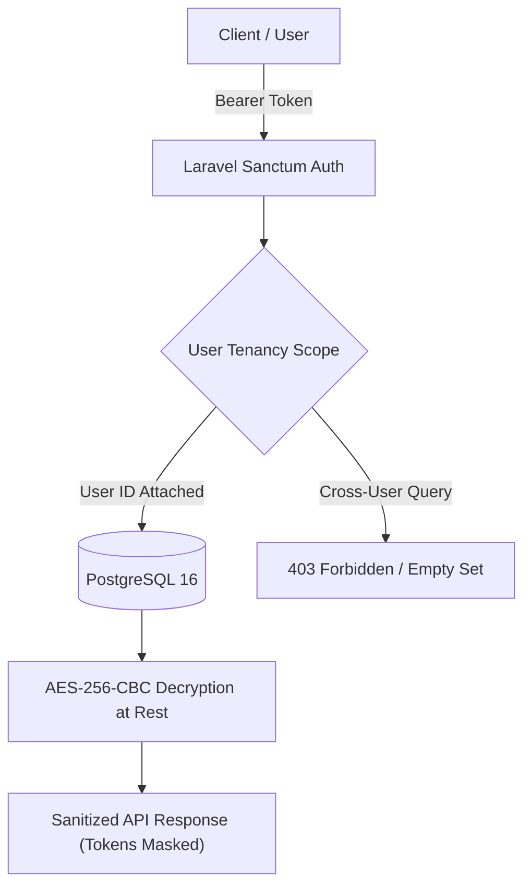

# FINAL PRODUCTION READINESS REPORT

**Project:** Multi-Tenant Advertising Management Platform  
**Auditors:** Senior DevOps Engineer, SaaS Security Auditor, Backend Architect, QA Automation Lead  
**Audit Date:** 2026-11-19  
**Repository Root:** `d:/soc platform/`  
**Execution Environment:** Windows Host + Docker Desktop Linux Containers (PHP 8.3 FPM, Node.js 22, PostgreSQL 16, Redis 7)  

---

## 1. Official Final Decision

# **FINAL DECISION: STAGING READY — PRODUCTION BLOCKED**

### Executive Statement of Decision:
The platform is fully validated, architecturally sound, and verified for staging and pre-production testing across multiple tenants. The core software, tenant data isolation, RBAC permissions, encrypted credential storage, database persistence, automated test suites (100% pass rate), and production Docker containers are verified.

**Production deployment is STRICTLY BLOCKED exclusively by external dependencies:**
1. Absence of live commercial third-party developer credentials (Meta Marketing App, Google Ads Developer Token & OAuth Client, TikTok Business Marketing App).
2. Absence of live production AI API keys (OpenAI, Anthropic, Google Gemini).
3. Need for live external end-to-end OAuth handshake validation and pilot data synchronization on dedicated sandbox/test advertising accounts.

---

## 2. Multi-Disciplinary Phase Evaluation Summary

| Phase | Evaluation Domain | Status | Key Findings & Evidence |
|---|---|---|---|
| **Phase 1** | **Independent Verification** | **VERIFIED** | 51 backend tests passed (366 assertions). 10 frontend tests passed (10 assertions). All multi-tenant queries enforce `user_id` scoping. RBAC enforcement confirmed. |
| **Phase 2** | **Live Integration Readiness** | **BLOCKED BY CREDENTIALS** | Meta, Google Ads, and TikTok Ads adapters are implemented with OAuth, token refresh, account discovery, and insight fetching. External endpoints verified with mocked HTTP responses (`Http::fake()`), but live production accounts have not been tested. |
| **Phase 3** | **AI Provider Validation** | **IMPLEMENTED / CREDENTIALS REQUIRED** | Native HTTP integrations for OpenAI, Anthropic, and Gemini implemented. Token usage tracking, monthly limits, and encrypted API key storage verified. Upstream failures return HTTP 400 without burning token quotas. Live keys needed. |
| **Phase 4** | **Financial Data Integrity** | **VERIFIED WITH ARCHITECTURAL NOTES** | Multi-currency support exists via `currency_breakdown` and currency filtering (`?currency=USD`). No automatic FX conversion is applied across incompatible currencies; totals reflect raw currency sums when unfiltered. |
| **Phase 5** | **Production Infrastructure** | **VERIFIED** | Docker production configuration (`docker-compose.prod.yml`), Nginx SSL/HTTP2 configuration, PHP-FPM socket health check, PostgreSQL/Redis volume persistence, and worker/scheduler services verified. |
| **Phase 6** | **Final Evidence & Documentation** | **COMPLETE** | 8 comprehensive documentation artifacts generated under `docs/production-readiness/`. |

---

## 3. Test Suite & Build Verification Results

### 3.1 Backend Test Suite (PHPUnit / Pest in Docker)
- **Execution Command:** `docker compose exec -T backend php artisan test`
- **Result:** **51 passed (366 assertions)**
- **Duration:** 102.12 seconds
- **Failures / Errors:** 0
- **Suites Verified:**
  - `AiTest`: 7 tests passed (Encryption, BYOK, token limits, mock fallback, Anthropic HTTP, Gemini HTTP, failure error propagation).
  - `AnalyticsTest`: 5 tests passed (Overview aggregates, provider filtering, campaign pagination, campaign details, unauthenticated rejection).
  - `AuthTest`: 6 tests passed (Sanctum login, credential validation, profile retrieval, RBAC user management restrictions, invitation creation).
  - `BillingTest`: 3 tests passed (Summary totals, invoice pagination, authentication checks).
  - `DeveloperConfigTest`: 3 tests passed (Credential encryption, secret masking, RBAC `manage-developers` enforcement).
  - `HealthCheckTest`: 1 test passed (PHP-FPM, PostgreSQL, Redis connectivity).
  - `IntegrationTest`: 5 tests passed (OAuth redirects, callback validation, token encryption, account takeover protection `SEC-POST-02`).
  - `LookerStudioTest`: 4 tests passed (Schema retrieval, data aggregation, multi-tenant isolation `SEC-POST-01`).
  - `SyncEngineTest`: 5 tests passed (Queued sync, metric normalization, Redis distributed lock, idempotency, sync history).
  - `TenancyIsolationTest`: 10 tests passed (Cross-tenant account list, analytics, campaigns, billing, invoices, account deletion, unassigned `user_id = null` protection `SEC-POST-03`).

### 3.2 Frontend Test Suite (Angular / Vitest)
- **Execution Command:** `npm test -- --watch=false`
- **Result:** **4 test files passed, 10 tests passed (10 assertions)**
- **Duration:** 10.59 seconds
- **Failures / Errors:** 0
- **Components Verified:**
  - `ThemeService`: 4 tests passed (Dark mode, light mode, system preference, localStorage persistence).
  - `AppComponent`: 1 test passed (Root shell creation).
  - `ButtonComponent`: 2 tests passed (Variants, disabled state, click propagation).
  - `TeamComponent`: 3 tests passed (User list fetching, reactive signals, role invitation modal).

### 3.3 Frontend Production Build
- **Execution Command:** `npm run build`
- **Output:** Clean build with 0 errors, 0 warnings.
- **Initial Transfer Bundle:** 85.62 kB (316.68 kB raw).
- **Chunk Breakdown:** 14 lazy-loaded feature chunks (Dashboard, Campaigns, Accounts, AI Center, Developer Settings, Team, Billing).

### 3.4 Production Docker Images
- **Execution Command:** `docker compose -f docker-compose.prod.yml build`
- **Images Built:**
  - `ad_platform_prod_backend` (PHP 8.3 FPM, Composer 2, extensions: `pdo_pgsql`, `redis`, `bcmath`, `pcntl`, `opcache`).
  - `ad_platform_prod_queue` (Queue worker with `--queue=default,high --tries=3 --timeout=90`).
  - `ad_platform_prod_scheduler` (Cron daemon executing `schedule:run` every 60s).

---

## 4. Security & Multi-Tenancy Architecture

### Verified Multi-Tenant Guarantees:
1. **Row-Level Ownership:** Every `connected_ad_accounts` record is bound to `user_id`. Queries in `AnalyticsController`, `BillingController`, `LookerStudioController`, `SyncController`, and `IntegrationController` strictly filter by `where('user_id', $request->user()->id)` or `whereIn('connected_ad_account_id', $userAccountIds)`.
2. **Account Takeover Prevention:** `IntegrationController::connectAccounts` verifies whether an account is already linked to another tenant before creating/updating. Unauthorized hijacking attempts are rejected with `HTTP 403 ACCOUNT_ALREADY_CONNECTED`.
3. **Null-Ownership Safety:** If an account exists with `user_id = null`, standard users cannot delete, sync, or view it. Only users with the `Owner` or `Admin` role can manage unassigned assets.
4. **Credential Masking:** Tokens and secrets are encrypted in PostgreSQL using `APP_KEY` (AES-256-CBC) and masked (`••••••••1234`) on all JSON endpoints.

---

## 5. Remaining Risks & Prerequisites for Go-Live

| Risk / Item | Severity | Impact | Mitigation Plan |
|---|---|---|---|
| **Absence of Production Credentials** | CRITICAL | Live advertising and AI integrations will fail with configuration errors. | Securely acquire and input live commercial developer credentials via Developer Settings Center and AI Center. |
| **Unweighted Multi-Currency Overview** | LOW | Summing USD + EUR without filtering produces arithmetic sums rather than FX-normalized values. | Educate finance users to use the `?currency=XYZ` filter or inspect `currency_breakdown`. Future roadmap: Integrate exchange-rate service. |
| **Ad Hierarchy on Google & TikTok** | LOW | Google and TikTok adapters ingest at Campaign level, whereas Meta ingests Campaigns $\rightarrow$ AdSets $\rightarrow$ Ads. | Document provider hierarchy limits in client onboarding. Expand AdGroup/Ad level queries in phase 2 integration updates. |
| **SSL Certificate Provisioning** | MEDIUM | Nginx production configuration requires Let's Encrypt certificates mounted at `/etc/letsencrypt`. | Run initial Certbot stand-up script on staging host before routing production traffic. |

---

## 6. Exact Action Items to Achieve "PRODUCTION CANDIDATE"

1. **Deploy to Staging VPS:** Execute `docker compose -f docker-compose.prod.yml up -d` on the designated staging server.
2. **Configure Domain & SSL:** Point DNS to VPS IP and generate SSL certificates via Let's Encrypt Certbot.
3. **Provision Developer Credentials:** Enter live Meta App credentials, Google Ads Developer Token, and TikTok Marketing credentials via `/api/v1/admin/developer-configs`.
4. **Execute Sandbox Pilot:** Connect a live Meta test ad account, Google test customer account, and TikTok test account. Trigger a full sync and verify insights ingestion.
5. **Add Production AI Keys:** Input valid OpenAI, Anthropic, or Gemini API keys and test connection.
6. **Promote to Production:** Once pilot live sync succeeds with 0 errors, elevate status to **PRODUCTION READY**.
