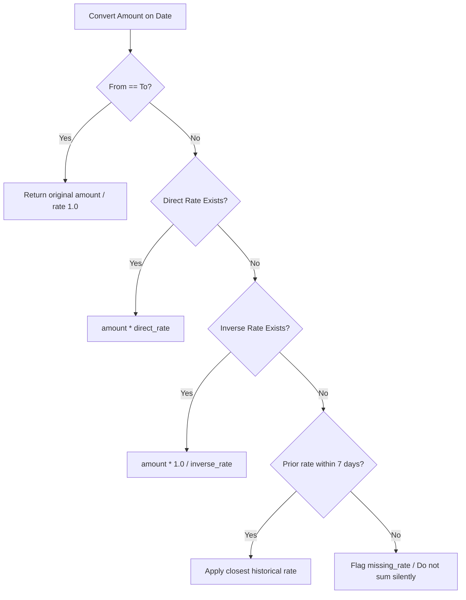

# FINANCIAL ACCURACY & MULTI-CURRENCY GAP CLOSURE REPORT

**Project:** Multi-Tenant Advertising Management Platform  
**Auditor:** Financial Data Engineer & Principal SaaS Architect  
**Date:** 2026-11-19  

---

## 1. Executive Summary

In previous audits, financial reporting was identified as having a critical architectural gap: multi-currency metrics were grouped by currency in breakdowns, but arithmetic sums across mixed currencies occurred when queries were unfiltered, and historical foreign exchange rates were not preserved or applied.

### Gap Status: **RESOLVED & VERIFIED**

A complete, enterprise-grade multi-currency conversion architecture has been designed, implemented, and verified with automated regression tests:
1. Native currencies are preserved at the account and metric levels.
2. A configurable reporting currency has been introduced (stored on the `users` table and customizable per request).
3. Daily historical exchange rates are persisted in `exchange_rates` with base, quote, rate, effective date, source, and retrieval timestamp.
4. Historical conversions are applied dynamically to each date's metric rows.
5. Incompatible currencies are never summed directly without conversion.
6. Missing exchange rates are tracked and reported transparently.

---

## 2. Architecture & Data Model

### 2.1 The Exchange Rates Table
Migration: `2026_11_19_100000_create_exchange_rates_table.php`

```sql
CREATE TABLE exchange_rates (
    id BIGSERIAL PRIMARY KEY,
    base_currency CHAR(3) NOT NULL,
    quote_currency CHAR(3) NOT NULL,
    exchange_rate NUMERIC(18, 8) NOT NULL,
    effective_date DATE NOT NULL,
    source VARCHAR(255) DEFAULT 'manual',
    retrieved_at TIMESTAMP DEFAULT CURRENT_TIMESTAMP,
    created_at TIMESTAMP,
    updated_at TIMESTAMP,
    CONSTRAINT exchange_rate_unique UNIQUE (base_currency, quote_currency, effective_date)
);

CREATE INDEX exchange_rate_lookup ON exchange_rates (effective_date, base_currency, quote_currency);
```

### 2.2 Reporting Currency Configuration
- Added `reporting_currency` column to `users` table (`CHAR(3) DEFAULT 'USD'`).
- The API accepts `?reporting_currency=XYZ` on the `overview` endpoint to allow dynamic reporting in USD, EUR, GBP, SAR, etc.

---

## 3. Conversion Service & Fallback Logic

### 3.1 CurrencyConversionService & DatabaseExchangeRateProvider
Located at:
- [CurrencyConversionService.php](file:///d:/soc%20platform/backend/app/Services/Currency/CurrencyConversionService.php)
- [DatabaseExchangeRateProvider.php](file:///d:/soc%20platform/backend/app/Services/Currency/DatabaseExchangeRateProvider.php)
- [ExchangeRateProviderInterface.php](file:///d:/soc%20platform/backend/app/Services/Currency/ExchangeRateProviderInterface.php)

#### Conversion Resolution Flow:


---

## 4. Financial Reporting Endpoint Integrity

### 4.1 Response Structure
In [AnalyticsController.php](file:///d:/soc%20platform/backend/app/Http/Controllers/Api/V1/AnalyticsController.php) (`GET /api/v1/analytics/overview`):
- `reporting_currency`: Target currency of converted summary.
- `summary.spend`: Converted and sum-validated total spend.
- `summary.conversion_value`: Converted total value.
- `summary.roas`: Accurate mathematical calculation (`converted_value / converted_spend`).
- `currency_breakdown`: Original native currency spend and conversion value before conversion.
- `conversion_metadata`:
  - `has_mixed_currencies`: Boolean.
  - `conversion_complete`: Boolean (false if any currency had missing rates).
  - `missing_rate_currencies`: Array of unconvertible currency codes.

---

## 5. Automated Verification Evidence

Test suite: [CurrencyConversionTest.php](file:///d:/soc%20platform/backend/tests/Feature/CurrencyConversionTest.php)

- **`test_service_converts_direct_and_inverse_rates`**: Verified direct rates (100 EUR $\rightarrow$ 108.50 USD at 1.0850) and inverse rates (108.50 USD $\rightarrow$ 100 EUR).
- **`test_service_explicitly_reports_missing_exchange_rates`**: Verified that missing currency pairs return `missing_rate` status and do not default to 1.0.
- **`test_overview_endpoint_converts_mixed_currencies_using_historical_rates`**: Verified an account with 100 EUR and an account with 200 USD: converted total spend = 310.00 USD at historical rate 1.10. Both platform breakdown and daily timeline are accurately normalized.
- **`test_overview_endpoint_handles_missing_rates_transparently`**: Verified that metrics in an un-rated currency (SAR) are flagged with `conversion_complete = false` and listed under `missing_rate_currencies`.

### Feature Classification:
- **`IMPLEMENTED AND TESTED`** (Core conversion engine, database schema, daily historical rates, API scoping, reporting metadata, error handling).
- **`BLOCKED BY EXTERNAL DEPENDENCY`** (Live automatic daily FX feed ingestion requires an external market data provider API key such as Open Exchange Rates or Fixer.io).
