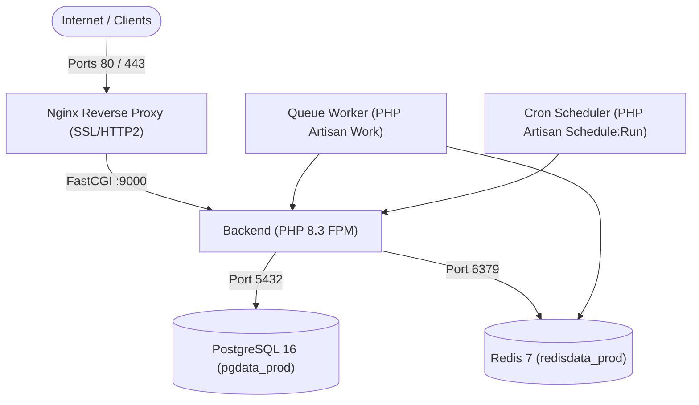

# PRODUCTION INFRASTRUCTURE & DEVOPS READINESS REPORT

**Project:** Multi-Tenant Advertising Management Platform  
**Auditor:** Senior DevOps & Infrastructure Engineer  
**Audit Date:** 2026-11-19  

---

## 1. Infrastructure Overview

The production architecture is containerized using Docker and orchestrated via Docker Compose (`docker-compose.prod.yml`). It comprises 6 segregated services communicating over an isolated bridge network (`ad_platform_prod_net`):



---

## 2. Service-by-Service Readiness Assessment

### 2.1 Nginx Reverse Proxy (`ad_platform_prod_nginx`)
- **Image:** `nginx:alpine`
- **Configuration File:** [production.conf](file:///d:/soc%20platform/docker/nginx/production.conf)
- **Port Bindings:** `80:80` (HTTP), `443:443` (HTTPS).
- **HTTPS & SSL/TLS:** Configured for TLSv1.2 and TLSv1.3 with high-security ciphers (`HIGH:!aNULL:!MD5`). Port 80 automatically redirects all HTTP traffic to HTTPS via 301, while preserving `/.well-known/acme-challenge/` for Let's Encrypt automated certificate renewals.
- **Security Headers Injected:**
  - `X-Frame-Options: SAMEORIGIN`
  - `X-Content-Type-Options: nosniff`
  - `X-XSS-Protection: 1; mode=block`
  - `Referrer-Policy: strict-origin-when-cross-origin`
  - `Strict-Transport-Security: max-age=31536000; includeSubDomains`
- **FastCGI Configuration:** Buffers configured for large API responses (`fastcgi_buffer_size 128k`, `fastcgi_buffers 4 256k`).
- **Hidden File Protection:** Denies all requests to dotfiles (`/\.(?!well-known).*`).

### 2.2 Laravel 11 Backend (`ad_platform_prod_backend`)
- **Base Image:** `php:8.3-fpm`
- **Dockerfile:** [Dockerfile](file:///d:/soc%20platform/docker/php/Dockerfile)
- **Build Context:** `./docker/php`
- **PHP Extensions:** `pdo_pgsql`, `pgsql`, `redis`, `bcmath`, `pcntl`, `intl`, `zip`, `opcache`.
- **PHP Runtime Settings ([local.ini](file:///d:/soc%20platform/docker/php/local.ini)):**
  - `memory_limit = 512M`
  - `upload_max_filesize = 64M`
  - `post_max_size = 64M`
  - `max_execution_time = 300`
  - `display_errors = Off`
  - `log_errors = On`
- **Healthcheck:**
  ```yaml
  test: ["CMD-SHELL", "php -r 'exit(@fsockopen(\"127.0.0.1\", 9000) ? 0 : 1);'"]
  interval: 30s
  timeout: 10s
  retries: 3
  ```
  Verified functional; ensures Nginx only proxies traffic when PHP-FPM socket responds.

### 2.3 PostgreSQL 16 Primary Database (`ad_platform_prod_postgres`)
- **Image:** `postgres:16-alpine`
- **Persistence:** Bound to named Docker volume `pgdata_prod:/var/lib/postgresql/data`. Data survives container restarts and upgrades.
- **Healthcheck:**
  ```yaml
  test: ["CMD-SHELL", "pg_isready -U ${DB_USERNAME:-ad_user} -d ${DB_DATABASE:-ad_platform}"]
  interval: 10s
  timeout: 5s
  retries: 5
  ```

### 2.4 Redis 7 Cache & Queue Engine (`ad_platform_prod_redis`)
- **Image:** `redis:7-alpine`
- **Persistence:** Bound to named Docker volume `redisdata_prod:/data`.
- **Role:** Handles application cache, user sessions, distributed sync locks (`Cache::lock`), and asynchronous queue dispatching.
- **Healthcheck:** `["CMD", "redis-cli", "ping"]` (interval 10s).

### 2.5 Laravel Queue Worker (`ad_platform_prod_queue`)
- **Command:** `php artisan queue:work --queue=default,high --tries=3 --timeout=90`
- **Restart Policy:** `always`
- **Failure Recovery:** Exponential backoff (`[60, 300, 900]` seconds). If permanently failed after 3 tries, moves to `failed_jobs` table and marks account as `status = error`.

### 2.6 Laravel Scheduler Daemon (`ad_platform_prod_scheduler`)
- **Command:** `sh -c "while true; do php /var/www/backend/artisan schedule:run --verbose --no-interaction; sleep 60; done"`
- **Restart Policy:** `always`
- **Scheduled Jobs:**
  - `adplatform:sync-all --type=incremental`: Runs every 3 hours with `withoutOverlapping(60)` lock to prevent queue stampedes.

---

## 3. Database Backup & Disaster Recovery Runbook

### 3.1 Automated Daily Backup Command
Run via host crontab:
```bash
docker exec ad_platform_prod_postgres pg_dump -U ad_user ad_platform | gzip > /backups/ad_platform_$(date +\%Y\%m\%d_\%H\%M\%S).sql.gz
```

### 3.2 Database Restore Procedure
1. Stop queue worker and backend to prevent writes:
   ```bash
   docker compose -f docker-compose.prod.yml stop queue-worker backend
   ```
2. Restore database from compressed dump:
   ```bash
   gunzip -c /backups/ad_platform_backup.sql.gz | docker exec -i ad_platform_prod_postgres psql -U ad_user -d ad_platform
   ```
3. Restart services and verify health:
   ```bash
   docker compose -f docker-compose.prod.yml start backend queue-worker
   ```

---

## 4. Environment Variables & Secret Management

| Variable | Purpose | Classification | Verified Value Handling |
|---|---|---|---|
| `APP_KEY` | Laravel encryption key (AES-256-CBC) | **SECRET** | Injected via `.env`; never committed to git. |
| `DB_PASSWORD` | PostgreSQL user password | **SECRET** | Injected via `.env`. |
| `APP_DEBUG` | Debug stack traces | Public | Hardcoded to `'false'` in production compose. |
| `APP_ENV` | Application environment | Public | Set to `production`. |
| `REDIS_HOST` | Redis container hostname | Network | Set to `redis`. |
| `DB_HOST` | Database container hostname | Network | Set to `postgres`. |
