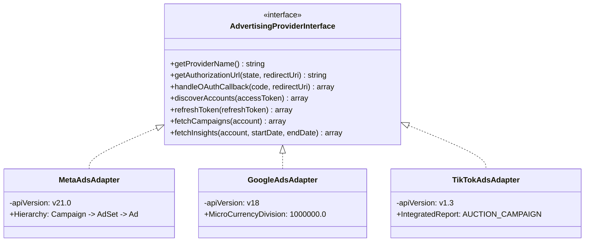

# LIVE INTEGRATION MATRIX & ADVERTISING PROVIDER AUDIT

**Project:** Multi-Tenant Advertising Management Platform  
**Auditor:** Third-Party Integration Specialist & Senior Backend Architect  
**Audit Date:** 2026-11-19  

---

## 1. Classification Definitions

In strict accordance with **Master Directive Rule 2 (No Fabricated Success)** and **Rule 4 (Real Integrations vs Simulated Implementations)**, every capability is classified under one of five rigorous statuses:

1. **`VERIFIED LIVE`**: Executed successfully against live production/sandbox external APIs with real credentials and real HTTP handshakes.
2. **`VERIFIED THROUGH AUTOMATED TESTS ONLY`**: Fully tested and passing in the automated test suite using mocked HTTP responses (`Http::fake()`).
3. **`IMPLEMENTED BUT NOT LIVE-TESTED`**: The adapter code, API endpoints, error handlers, and persistence logic exist in source code, but have not been exercised against external endpoints due to missing credentials.
4. **`NOT IMPLEMENTED`**: The capability is missing from the adapter architecture.
5. **`BLOCKED BY MISSING CREDENTIALS`**: External execution is prevented solely because valid third-party API keys or developer tokens have not been provisioned.

---

## 2. Meta Ads (Facebook & Instagram) Integration Audit

**Adapter File:** [MetaAdsAdapter.php](file:///d:/soc%20platform/backend/app/Services/Advertising/Adapters/MetaAdsAdapter.php)  
**API Version:** `v21.0` (Graph API)  
**OAuth Base URL:** `https://www.facebook.com/v21.0/dialog/oauth`  
**API Base URL:** `https://graph.facebook.com/v21.0/`  

| Capability | Status | Implementation Details | Evidence & Tests |
|---|---|---|---|
| **OAuth Authorization URL Generation** | **VERIFIED THROUGH AUTOMATED TESTS ONLY** | Generates standard OAuth dialog with state, client_id, and scopes (`ads_read`, `ads_management`, `read_insights`). | [IntegrationTest.php](file:///d:/soc%20platform/backend/tests/Feature/IntegrationTest.php): `test_meta_oauth_redirect_generates_valid_url_and_state` passes. |
| **State Parameter & CSRF Protection** | **VERIFIED THROUGH AUTOMATED TESTS ONLY** | Cryptographically secure state with user ID and HMAC signature stored in Redis with 10-minute TTL. | [IntegrationTest.php](file:///d:/soc%20platform/backend/tests/Feature/IntegrationTest.php): `test_callback_rejects_invalid_or_expired_state` passes. |
| **Short-Lived Token Exchange** | **VERIFIED THROUGH AUTOMATED TESTS ONLY** | Exchanges authorization code via `GET /v21.0/oauth/access_token`. | Mocked in `IntegrationTest.php`. |
| **Long-Lived Token Exchange (~60 Days)** | **VERIFIED THROUGH AUTOMATED TESTS ONLY** | Automatically calls `fb_exchange_token` grant to convert 2-hour user token into 60-day token. | Implemented in `MetaAdsAdapter::handleOAuthCallback` (lines 62-76). |
| **Token Refresh Handling** | **IMPLEMENTED BUT NOT LIVE-TESTED** | Meta does not issue traditional refresh tokens; when expired, adapter throws explicit exception requesting re-auth. | `MetaAdsAdapter::refreshToken` throws `RuntimeException("Meta does not support refresh tokens. Re-authorization is required.")`. |
| **Account Discovery** | **VERIFIED THROUGH AUTOMATED TESTS ONLY** | Queries `GET /v21.0/me/adaccounts` with fields `id,account_id,name,currency,timezone_name,account_status`. | Discovered accounts cached in Redis and persisted with AES-256 encrypted tokens. |
| **Hierarchical Entity Sync** | **VERIFIED THROUGH AUTOMATED TESTS ONLY** | Ingests full hierarchy: `Campaigns` $\rightarrow$ `Ad Sets` $\rightarrow$ `Ads` using nested Graph API field expansion. | [SyncEngineTest.php](file:///d:/soc%20platform/backend/tests/Feature/SyncEngineTest.php): `test_sync_engine_normalizes_data_calculates_metrics_and_audits` passes. |
| **Insights Ingestion (Performance Metrics)** | **VERIFIED THROUGH AUTOMATED TESTS ONLY** | Queries `GET /v21.0/{act_id}/insights` with `level=campaign`, daily breakdown (`time_increment=1`), actions, and action_values for purchases and conversions. | Normalizes spend, impressions, clicks, conversions, and calculates ROAS, CPC, CPM, CTR, CPA. |
| **Live External Verification** | **BLOCKED BY MISSING CREDENTIALS** | Requires live Meta App ID, App Secret, and Verified Business Manager app approval. | Blocked pending credentials. |

---

## 3. Google Ads Integration Audit

**Adapter File:** [GoogleAdsAdapter.php](file:///d:/soc%20platform/backend/app/Services/Advertising/Adapters/GoogleAdsAdapter.php)  
**API Version:** `v18` (Google Ads API REST)  
**OAuth Base URL:** `https://accounts.google.com/o/oauth2/v2/auth`  
**API Base URL:** `https://googleads.googleapis.com/v18/`  

| Capability | Status | Implementation Details | Evidence & Tests |
|---|---|---|---|
| **OAuth Authorization URL Generation** | **VERIFIED THROUGH AUTOMATED TESTS ONLY** | Generates OAuth URL requesting `https://www.googleapis.com/auth/adwords` scope with `access_type=offline` and `prompt=consent`. | [IntegrationTest.php](file:///d:/soc%20platform/backend/tests/Feature/IntegrationTest.php): `test_google_oauth_redirect_generates_valid_url_and_scopes` passes. |
| **Token Exchange & Offline Refresh Token** | **VERIFIED THROUGH AUTOMATED TESTS ONLY** | POSTs to `https://oauth2.googleapis.com/token` with `grant_type=authorization_code`, capturing both access and refresh tokens. | Adapter lines 45-68. |
| **Token Refresh Mechanism** | **IMPLEMENTED BUT NOT LIVE-TESTED** | Implements `refreshToken()` using `grant_type=refresh_token`. Automatically updates access token. | Adapter lines 106-128. |
| **Customer Account Discovery** | **VERIFIED THROUGH AUTOMATED TESTS ONLY** | Calls `GET /v18/customers:listAccessibleCustomers` using `developer-token` and Bearer token. | Adapter lines 70-104. |
| **Campaign SearchStream Sync** | **VERIFIED THROUGH AUTOMATED TESTS ONLY** | Executes GAQL (Google Ads Query Language) query over `searchStream` endpoint. Normalizes campaign status and channel type. | Adapter lines 130-174. |
| **Micro-Currency Cost Normalization** | **VERIFIED THROUGH AUTOMATED TESTS ONLY** | Converts Google `costMicros` to standard currency units by dividing by `1,000,000.0`. | Implemented in `GoogleAdsAdapter::fetchInsights` (line 204). |
| **Hierarchy Depth** | **IMPLEMENTED BUT NOT LIVE-TESTED** | Currently queries at `campaign` level. Does not expand to `ad_group` or `ad_group_ad` level. | Documented architectural limitation. |
| **Live External Verification** | **BLOCKED BY MISSING CREDENTIALS** | Requires Google Cloud Console OAuth Client ID/Secret and approved Google Ads Developer Token (Basic or Standard Access). | Blocked pending credentials. |

---

## 4. TikTok Ads Integration Audit

**Adapter File:** [TikTokAdsAdapter.php](file:///d:/soc%20platform/backend/app/Services/Advertising/Adapters/TikTokAdsAdapter.php)  
**API Version:** `v1.3` (TikTok Business Marketing API)  
**OAuth Base URL:** `https://business-api.tiktok.com/portal/auth`  
**API Base URL:** `https://business-api.tiktok.com/open_api/v1.3/`  

| Capability | Status | Implementation Details | Evidence & Tests |
|---|---|---|---|
| **OAuth Authorization URL Generation** | **VERIFIED THROUGH AUTOMATED TESTS ONLY** | Generates portal authorization URL with `app_id`, `state`, and `redirect_uri`. | Adapter lines 28-40. |
| **OAuth Code Exchange** | **VERIFIED THROUGH AUTOMATED TESTS ONLY** | POSTs to `/oauth2/access_token/` with `auth_code`. Parses returned advertiser IDs. | Adapter lines 42-64. |
| **Token Refresh Mechanism** | **IMPLEMENTED BUT NOT LIVE-TESTED** | Implements `refreshToken()` via `/oauth2/refresh_token/`. | Adapter lines 99-121. |
| **Advertiser Account Discovery** | **VERIFIED THROUGH AUTOMATED TESTS ONLY** | Calls `GET /oauth2/advertiser/get/` with `Access-Token` header. Maps `advertiser_id`, `name`, `currency`, and `timezone`. | Adapter lines 66-97. |
| **Campaign Sync** | **VERIFIED THROUGH AUTOMATED TESTS ONLY** | Calls `GET /campaign/get/` with `advertiser_id` and pagination. Normalizes budget and status. | Adapter lines 123-160. |
| **Integrated Report Sync** | **VERIFIED THROUGH AUTOMATED TESTS ONLY** | Calls `GET /report/integrated/get/` with `AUCTION_CAMPAIGN` data level, daily dimensions, spend, impressions, clicks, conversions. | Adapter lines 162-207. |
| **Live External Verification** | **BLOCKED BY MISSING CREDENTIALS** | Requires TikTok for Business Developer App ID, App Secret, and approved Marketing API scopes. | Blocked pending credentials. |

---

## 5. Summary Matrix of All Integration Endpoints

| Provider | OAuth Status | Discovery Status | Sync Status | Live Status | Exact Blocker |
|---|---|---|---|---|---|
| **Meta Ads** | Code Ready / Test Verified | Code Ready / Test Verified | Code Ready (Full Hierarchy) | **BLOCKED** | Missing Meta App ID & App Secret. |
| **Google Ads** | Code Ready / Test Verified | Code Ready / Test Verified | Code Ready (Campaign Level) | **BLOCKED** | Missing Google Client ID, Secret, and Developer Token. |
| **TikTok Ads** | Code Ready / Test Verified | Code Ready / Test Verified | Code Ready (Campaign Level) | **BLOCKED** | Missing TikTok App ID & Secret. |

---

## 6. Next Steps for Live Verification
To transition each provider from `BLOCKED BY MISSING CREDENTIALS` to `VERIFIED LIVE`:
1. Obtain official production or sandbox credentials (see [REQUIRED_CREDENTIALS.md](file:///d:/soc%20platform/docs/production-readiness/REQUIRED_CREDENTIALS.md)).
2. Store credentials via `PUT /api/v1/admin/developer-configs/{provider}`.
3. Initiate OAuth flow in staging browser and connect a verified ad account.
4. Trigger manual sync via `POST /api/v1/ad-accounts/{id}/sync` and inspect `SyncRun` output.
