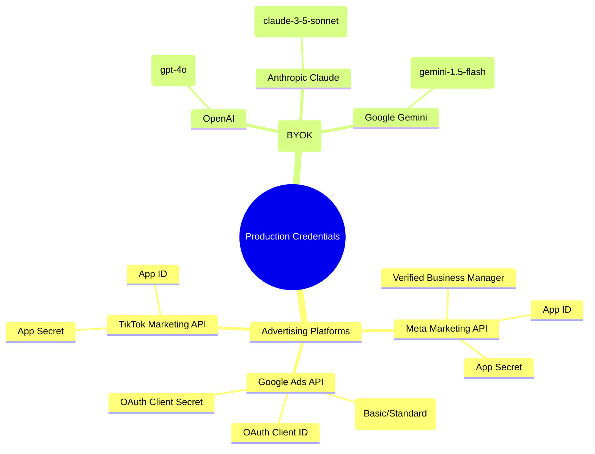

# REQUIRED COMMERCIAL CREDENTIALS SPECIFICATION

**Project:** Multi-Tenant Advertising Management Platform  
**Purpose:** Comprehensive guide for the Developer / Client specifying exact commercial developer credentials and API keys required to unblock live production operations.  
**Security Notice:** Never post credentials in plaintext in pull requests, issues, or chats. All credentials must be entered directly through the authenticated UI centers.

---

## 1. Summary of Required Credentials

---

## 2. Meta Ads (Facebook & Instagram)

### 2.1 Required Values
- **Meta App ID:** (Numeric string, e.g. `123456789012345`)
- **Meta App Secret:** (Alphanumeric secret, 32 characters)
- **API Version:** Default is `v21.0`.

### 2.2 Permissions & Scopes Required in Meta Developer Portal
Your Meta App must have the **Marketing API** product enabled with the following permissions:
- `ads_read`: Read ad accounts, campaigns, and creatives.
- `ads_management`: Manage ads and campaigns.
- `read_insights`: Read aggregated performance insights.

### 2.3 Required OAuth Redirect URI
Configure in Meta App Settings $\rightarrow$ Facebook Login $\rightarrow$ Valid OAuth Redirect URIs:
- Staging: `https://staging.adplatform.com/api/v1/integrations/oauth/meta/callback`
- Production: `https://app.adplatform.com/api/v1/integrations/oauth/meta/callback`

### 2.4 How to Configure
Login as **Owner** or **Admin**, navigate to **Developer Settings** (`/admin/developer-configs`), select **Meta**, enter App ID & App Secret, and click **Save & Test Connection**.

---

## 3. Google Ads

### 3.1 Required Values
- **Developer Token:** (22-character token from Google Ads Manager Account / MCC). Must have at least **Basic Access** or **Standard Access**.
- **OAuth Client ID:** (Ends in `.apps.googleusercontent.com` from Google Cloud Console).
- **OAuth Client Secret:** (Client secret from Google Cloud Console).
- **API Version:** Default is `v18`.

### 3.2 Required Scopes in Google Cloud Console
Enable the **Google Ads API** in Google Cloud Console and add the following OAuth scope:
- `https://www.googleapis.com/auth/adwords`

### 3.3 Required Authorized Redirect URI
In Google Cloud Console $\rightarrow$ APIs & Services $\rightarrow$ Credentials $\rightarrow$ OAuth 2.0 Client IDs:
- Staging: `https://staging.adplatform.com/api/v1/integrations/oauth/google/callback`
- Production: `https://app.adplatform.com/api/v1/integrations/oauth/google/callback`

### 3.4 How to Configure
In **Developer Settings** (`/admin/developer-configs`), select **Google**, enter Client ID, Client Secret, and Developer Token, and click **Save & Test Connection**.

---

## 4. TikTok Ads

### 4.1 Required Values
- **TikTok App ID:** (Numeric or alphanumeric App ID from TikTok for Business Developer Portal).
- **TikTok App Secret:** (Secret from TikTok Developer Portal).
- **API Version:** Default is `v1.3`.

### 4.2 Approved Scopes & Products
In TikTok Developer Portal, create an App under **Marketing API** with:
- **Ads Management Scope:** Read/Write campaigns, ad groups, and creatives.
- **Reporting Scope:** Access `/report/integrated/get/` metrics.

### 4.3 Required Authorized Redirect URI
- Staging: `https://staging.adplatform.com/api/v1/integrations/oauth/tiktok/callback`
- Production: `https://app.adplatform.com/api/v1/integrations/oauth/tiktok/callback`

### 4.4 How to Configure
In **Developer Settings** (`/admin/developer-configs`), select **TikTok**, enter App ID & Secret, and click **Save & Test Connection**.

---

## 5. AI Providers (Bring Your Own Key - BYOK)

The platform supports multiple AI providers for ad copy generation and campaign optimization. At least one provider must be configured:

### 5.1 OpenAI
- **Key Format:** `sk-proj-...`
- **Supported Models:** `gpt-4o`, `gpt-4o-mini`, `gpt-4-turbo`
- **Configuration Path:** In **AI Center** (`/ai/config`), choose OpenAI, paste API key, configure optional monthly token limit (e.g. 500,000 tokens), and click **Test Connection**.

### 5.2 Anthropic Claude
- **Key Format:** `sk-ant-...`
- **Supported Models:** `claude-3-5-sonnet-20241022`, `claude-3-haiku-20240307`
- **Configuration Path:** In **AI Center**, choose Anthropic, paste API key, and test connection.

### 5.3 Google Gemini
- **Key Format:** `AIzaSy...` (from Google AI Studio or Google Cloud Vertex AI)
- **Supported Models:** `gemini-1.5-flash`, `gemini-1.5-pro`
- **Configuration Path:** In **AI Center**, choose Gemini, paste API key, and test connection.
