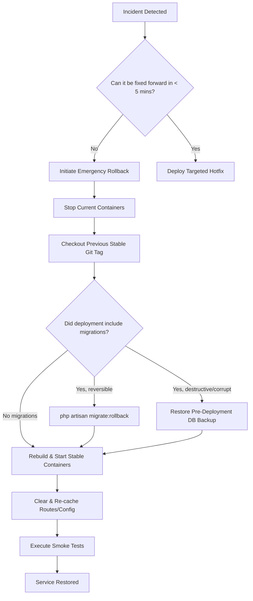

# PRODUCTION ROLLBACK & RECOVERY PLAN

**Project:** Multi-Tenant Advertising Management Platform  
**Auditor:** Senior Site Reliability Engineer & Application Architect  
**Audit Date:** 2026-11-19  

---

## 1. Rollback Trigger Criteria

A rollback must be initiated immediately if any of the following occur during or immediately following deployment:

1. **Service Outage:** `GET /api/v1/health` returns HTTP 500, 502, or 504 for > 2 consecutive minutes.
2. **Database Failure:** Database migrations fail midway with unhandled SQL exceptions or table locking.
3. **Multi-Tenant Leak:** Any cross-tenant data access anomaly is detected in production.
4. **Queue Worker Crash:** Queue worker exits or continuously fails to process synchronization jobs.
5. **Critical Feature Regression:** User authentication (Sanctum) fails for all users.

---

## 2. Emergency Rollback Procedures



---

## 3. Detailed Step-by-Step Rollback Execution

### Step 1: Notify Operations & Set Maintenance Page
If Nginx is reachable, place temporary 503 maintenance mode:
```bash
docker exec ad_platform_prod_backend php artisan down --secret="ops-bypass-key" --render="errors::503"
```

### Step 2: Roll Back Database Schema (If Migrations Were Run)
If the new migration has a reversible `down()` method:
```bash
docker compose -f docker-compose.prod.yml exec backend php artisan migrate:rollback --step=1 --force
```

If the database was corrupted or migration was destructive, restore the pre-deployment snapshot:
```bash
# 1. Stop backend and worker containers to sever active DB connections
docker compose -f docker-compose.prod.yml stop backend queue-worker scheduler

# 2. Drop and restore from pre-deployment backup
docker exec -i ad_platform_prod_postgres dropdb -U ad_user ad_platform
docker exec -i ad_platform_prod_postgres createdb -U ad_user ad_platform
gunzip -c /backups/pre_deploy_backup.sql.gz | docker exec -i ad_platform_prod_postgres psql -U ad_user -d ad_platform
```

### Step 3: Check Out Previous Stable Git Release Tag
```bash
cd /opt/ad-platform
git checkout <previous_stable_tag_or_commit>
```

### Step 4: Rebuild & Restart Container Fleet
```bash
docker compose -f docker-compose.prod.yml down
docker compose -f docker-compose.prod.yml up -d --build
```

### Step 5: Refresh Application Caches & Bring App Live
```bash
docker compose -f docker-compose.prod.yml exec backend php artisan optimize:clear
docker compose -f docker-compose.prod.yml exec backend php artisan config:cache
docker compose -f docker-compose.prod.yml exec backend php artisan route:cache
docker compose -f docker-compose.prod.yml exec backend php artisan up
```

### Step 6: Post-Rollback Smoke Verification
1. Run health check:
   ```bash
   curl -I https://api.adplatform.com/api/v1/health
   ```
2. Verify queue worker is running:
   ```bash
   docker compose -f docker-compose.prod.yml logs queue-worker --tail=50
   ```
3. Test login from frontend.

---

## 4. Postmortem & Incident Review Template

Within 24 hours of any production rollback, the engineering team must complete an Incident Postmortem:
- **Incident Date & Time:**
- **Duration of Impact:**
- **Triggering Event / Root Cause:**
- **Why Automated Tests Did Not Catch the Issue:**
- **Corrective Actions to Prevent Recurrence:**
- **Sign-off:** Lead Architect & DevOps Lead.
