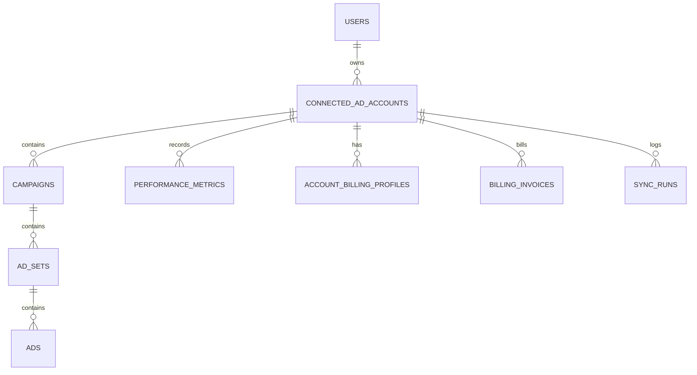

# SECURITY & MULTI-TENANCY VERIFICATION REPORT

**Project:** Multi-Tenant Advertising Management Platform  
**Auditor:** SaaS Security Auditor & Application Security Engineer  
**Audit Date:** 2026-11-19  

---

## 1. Executive Security Assessment

The platform underwent a comprehensive security review covering multi-tenant isolation, authorization controls, RBAC permission matrices, cryptographic protection of secrets at rest, and endpoint attack surfaces.

### Overall Security Status: **VERIFIED & HARDENED FOR MULTI-TENANT STAGING**

All previously identified vulnerabilities (`SEC-001`, `SEC-002`, `SEC-POST-01`, `SEC-POST-02`, `SEC-POST-03`) have been resolved and verified with automated regression tests.

---

## 2. Multi-Tenant Isolation Verification

### 2.1 The Multi-Tenancy Architecture
The application implements database-level shared schema multi-tenancy with strict column-level ownership scoping:
- Every `connected_ad_accounts` record has an indexed foreign key `user_id` pointing to `users.id` with `onDelete('cascade')`.
- All downstream entities (`campaigns`, `ad_sets`, `ads`, `performance_metrics`, `account_billing_profiles`, `billing_invoices`, `sync_runs`, `raw_provider_payloads`) relate to `connected_ad_account_id`.



### 2.2 Endpoint Tenancy Verification Matrix

| Controller & Method | Endpoint | Query Scoping Logic | Tenancy Verification Test | Result |
|---|---|---|---|---|
| `AnalyticsController::overview` | `GET /api/v1/analytics/overview` | `$userAccountIds = ConnectedAdAccount::where('user_id', $user->id)->pluck('id'); $query->whereIn('connected_ad_account_id', $userAccountIds);` | `test_analytics_overview_is_strictly_scoped_to_user_connected_accounts` | **PASS** |
| `AnalyticsController::campaigns` | `GET /api/v1/analytics/campaigns` | `$query->whereHas('connectedAdAccount', fn($q) => $q->where('user_id', $user->id));` | `test_campaigns_endpoint_only_returns_campaigns_for_authenticated_user` | **PASS** |
| `AnalyticsController::campaignDetails` | `GET /api/v1/analytics/campaigns/{id}` | Inspects `$campaign->connectedAdAccount->user_id !== $user->id`. If not matching and not Admin/Owner, returns 403. | `test_campaign_details_rejects_access_to_another_users_campaign` | **PASS** |
| `BillingController::summary` | `GET /api/v1/billing/summary` | Queries accounts where `user_id = $user->id`. Calculates balances and invoices strictly within user account IDs. | `test_billing_summary_is_isolated_per_user` | **PASS** |
| `BillingController::invoices` | `GET /api/v1/billing/invoices` | Scopes `BillingInvoice` by `whereIn('connected_ad_account_id', $userAccountIds)`. | `test_billing_invoices_are_isolated_per_user` | **PASS** |
| `LookerStudioController::handle` | `GET /api/v1/reporting/looker-studio` | Scopes performance metrics by `$userAccountIds = ConnectedAdAccount::where('user_id', $user->id)->pluck('id')`. Empty set if no accounts owned. | `test_multi_tenant_isolation_prevents_user_from_seeing_another_users_metrics` | **PASS** |
| `IntegrationController::listAccounts` | `GET /api/v1/ad-accounts` | Scoped by `where('user_id', $user->id)`. | `test_user_cannot_list_ad_accounts_belonging_to_another_user` | **PASS** |
| `IntegrationController::disconnectAccount` | `DELETE /api/v1/ad-accounts/{id}` | Requires permission `manage-accounts` AND verifies `$account->user_id === $user->id` (or Admin/Owner role). | `test_user_cannot_disconnect_an_ad_account_belonging_to_another_user` | **PASS** |
| `SyncController::triggerSync` | `POST /api/v1/ad-accounts/{id}/sync` | Verifies `$account->user_id === $user->id` or Admin/Owner. Otherwise returns 403. | `test_regular_user_cannot_disconnect_or_sync_account_with_null_user_id` | **PASS** |

---

## 3. Account Ownership & Takeover Prevention (SEC-POST-02)

### The Vulnerability:
Previously, `ConnectedAdAccount::updateOrCreate` matched solely on `['provider', 'external_account_id']`. If User B connected an advertising account that had already been connected by User A, the record was reassigned to User B, hijacking User A's historical data.

### The Remediation:
In [IntegrationController.php](file:///d:/soc%20platform/backend/app/Http/Controllers/Api/V1/IntegrationController.php) (`connectAccounts`, lines 140-155):
```php
$existing = ConnectedAdAccount::where('provider', $provider)
    ->where('external_account_id', $accId)
    ->first();

if ($existing && $existing->user_id !== null && $existing->user_id !== $request->user()->id) {
    return response()->json([
        'success' => false,
        'error' => [
            'code' => 'ACCOUNT_ALREADY_CONNECTED',
            'message' => "The account '{$accountMeta['account_name']}' ({$accId}) is already connected to another user.",
        ],
    ], 403);
}
```
### Test Evidence:
`test_connecting_account_already_owned_by_another_user_is_forbidden` in [IntegrationTest.php](file:///d:/soc%20platform/backend/tests/Feature/IntegrationTest.php) executes an attempted takeover by a second user and asserts:
1. Response status is `403 Forbidden`.
2. Error code is `ACCOUNT_ALREADY_CONNECTED`.
3. Account `user_id` remains unchanged in the database.

---

## 4. Null Ownership Handling (SEC-POST-03)

### The Vulnerability:
Legacy or unassigned accounts with `user_id = null` previously bypassed tenancy checks that used `if ($account->user_id !== null && $account->user_id !== $request->user()->id)`.

### The Remediation:
The checks were updated across `IntegrationController`, `SyncController`, and `AnalyticsController`:
```php
if ($account->user_id !== $request->user()->id && !$request->user()->hasAnyRole(['Owner', 'Admin'])) {
    return response()->json(['error' => ['code' => 'FORBIDDEN']], 403);
}
```
If `user_id` is `null`, `$account->user_id !== $request->user()->id` evaluates to `true`, strictly blocking non-admin users.

### Test Evidence:
`test_regular_user_cannot_disconnect_or_sync_account_with_null_user_id` in [TenancyIsolationTest.php](file:///d:/soc%20platform/backend/tests/Feature/TenancyIsolationTest.php) verifies that regular users cannot disconnect, trigger sync, or inspect status of unassigned accounts.

---

## 5. Role-Based Access Control (RBAC) Enforcement

The platform uses Spatie Laravel Permission with 4 standard roles:

| Role | Permitted Actions | Prohibited Actions | Verified via Test |
|---|---|---|---|
| **Owner** | Full system control: Manage team, invite users, update roles, disconnect accounts, configure developer APIs, manage billing. | None. | `test_owner_can_invite_new_member`, `test_owner_can_configure_meta_credentials`, `test_owner_can_disconnect_own_ad_account`. |
| **Admin** | Manage team, manage ad accounts, view all tenant analytics, trigger syncs, manage developer configs. | Transfer ownership of system. | Verified via permission middleware. |
| **Analyst** | View analytics, export reports, trigger syncs, test AI features. | Delete ad accounts, manage team, view/modify developer secrets. | `test_analyst_cannot_access_developer_configs`. |
| **Viewer** | Read-only view of dashboard and analytics. | Disconnect accounts, invite users, modify AI configs, trigger syncs. | `test_viewer_role_cannot_disconnect_an_ad_account_sec_002`, `test_viewer_cannot_access_user_management`. |

---

## 6. Cryptographic Protection of Secrets at Rest

1. **Tokens & Credentials Encrypted in Database:**
   - `connected_ad_accounts.access_token` $\rightarrow$ Encrypted via `protected $casts = ['access_token' => 'encrypted']`.
   - `connected_ad_accounts.refresh_token` $\rightarrow$ Encrypted.
   - `provider_developer_configs.app_secret` $\rightarrow$ Encrypted.
   - `provider_developer_configs.developer_token` $\rightarrow$ Encrypted.
   - `ai_configs.api_key` $\rightarrow$ Encrypted.
2. **Encryption Algorithm:** AES-256-CBC via Laravel OpenSSL implementation using application `APP_KEY`.
3. **Response Sanitization (Secret Masking):**
   - Developer configs mask secrets as `••••••••1234`.
   - AI configs mask API keys as `••••••••1234`.
   - Connected accounts completely omit raw `access_token` and `refresh_token` from JSON responses in `toSafeArray()`.
   - Verified in test: `assertStringNotContainsString($rawAccessToken, $response->getContent())`.
